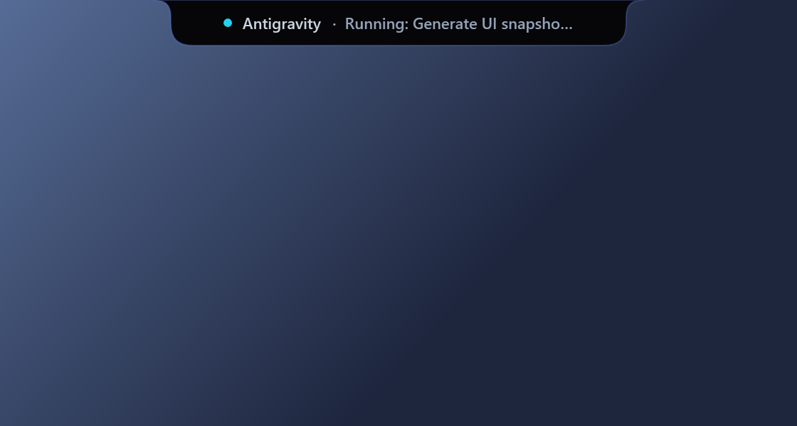
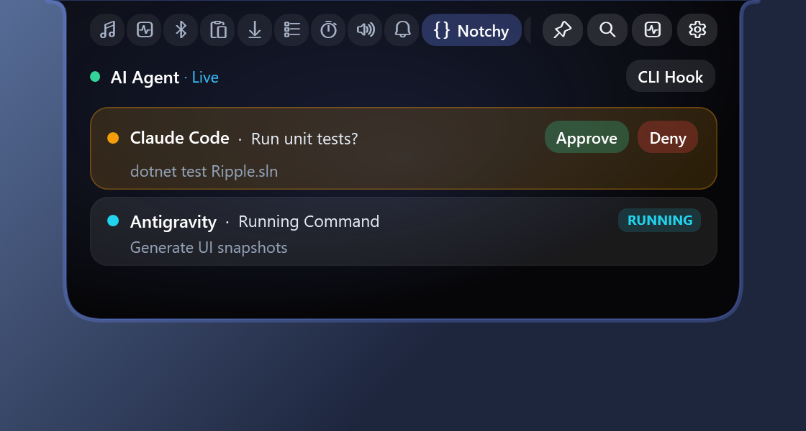
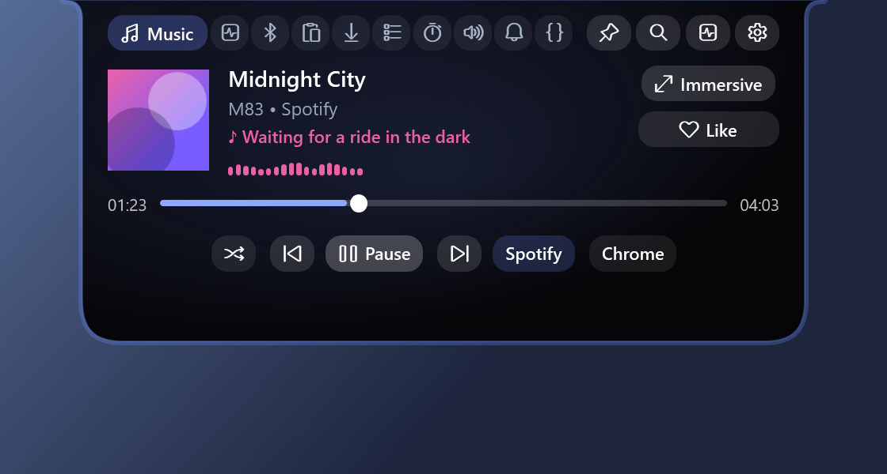
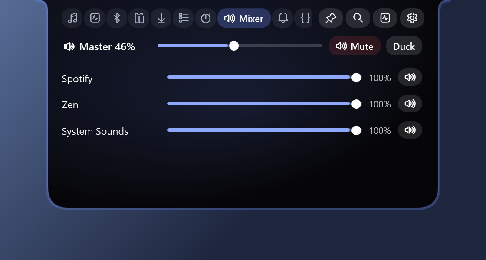
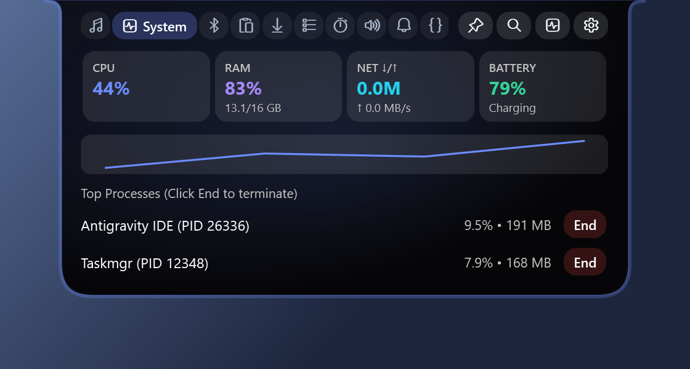

<div align="center">

# Ripple

**A fluid, GPU-composited Dynamic Island & control hub for Windows 10 & 11.**

*One glance for information. One hover for control. One click for depth.*

%20%7C%2011-0078D4?style=flat-square)


</div>

---

> **About:** Ripple rests unobtrusively along the top edge of your screen with concave-ear bezel curves, swells subtly as your cursor approaches (`Peek`), blooms cleanly via interruptible spring physics on hover (`Expanded`), and keeps a diagonal safe corridor so moving into controls never collapses it — without ever stealing window focus or covering fullscreen games.

## Visual Preview

<div align="center">

| Minimized Agent Glance | Notchy — Live AI Agent Monitor |
| :---: | :---: |
|  |  |

| Music & Synced Lyrics | Per-App CoreAudio Mixer | System Monitor |
| :---: | :---: | :---: |
|  |  |  |

</div>

---

## Highlights

- **Spring-Physics Motion & Concave-Ear Geometry**
  - Analytical VSync-locked springs (`Expand`, `Collapse`, `Peek`, `Press`, `Dodge`) synchronized with `CompositionTarget.Rendering` (60 / 120 / 144 / 240 Hz).
  - Interruptible mid-flight reversals preserve velocity with zero snap.
  - Non-activating click-through Win32 windowing (`WM_NCHITTEST` / `MA_NOACTIVATE`) with diagonal `SafeCorridorHitTester`.
- **Prioritized AI Agent Tracking (`Notchy`)**
  - **Zero-config Antigravity live tracking:** Automatically tails Antigravity `transcript.jsonl` files in real time.
  - **Minimized live status:** Displays the running agent dot, name, and active action right beside it while collapsed (prioritized above background media).
  - **Completion chime & approvals:** Plays a subtle two-tone bell chime when execution finishes and surfaces interactive **Approve / Deny** actions for permission requests (`Antigravity` and CLI hooks for Claude Code / Codex / Gemini CLI).
- **11 Built-in Modules + Plugin SDK**
  1. **Music & Media (`music`)** — Windows SMTC integration, dynamic album-art color extraction, 24-band live equalizer, scrubbable seek slider, cached LRCLIB synced lyrics, and Fullscreen Music mode.
  2. **Per-App Volume Mixer (`mixer`)** — Direct WASAPI CoreAudio master + per-process volume sliders, mute toggles, active audio highlighting, Duck Others mode, and coalesced Volume / Mic-Mute / Caps-Lock HUDs.
  3. **Notchy (`notchy`)** — Minimalist AI agent & Git status dashboard with zero-config Antigravity tracking and CLI webhook support.
  4. **System Monitor (`system`)** — Adaptive polling (`1s` expanded / `5s` rest), CPU / RAM / Disk / Network / Battery cards, 60s sparklines, and confirmed process End Task.
  5. **Bluetooth & Devices (`bluetooth`)** — Paired/connected devices, battery levels, and AirPods-style connect capsules.
  6. **Clipboard Pro (`clipboard`)** — AES-256-GCM encrypted history with Windows DPAPI protection, smart detectors (URLs, hex color swatches, JSON prettifier, inline math, auto-expiring OTP codes), and password-manager exclusion.
  7. **Drop Shelf (`shelf`)** — Drag files, folders, images, or links onto the notch with Zip creation, PNG conversion, Copy Path, and timed auto-expiry.
  8. **Quick Apps & Command Palette (`apps`)** — App launcher rail with running indicators plus `Ctrl+Alt+Space` Command Palette (calculator, unit conversion, web search, quick commands).
  9. **Focus Timer (`timer`)** — Pomodoro / countdown / stopwatch with rest perimeter progress ring, Focus Mode suppression, to-dos, and meeting glance.
  10. **Notifications (`notifications`)** — `UserNotificationListener` integration, local API alerts, and per-app mute controls.
  11. **Utilities (`utilities`)** — Screen region capture, pixel color eyedropper, snap-to-shelf screenshot, Keep Awake toggle, Windows Dark Mode toggle, Mic mute, world clocks, weather glance, and QR generator.
- **Smart Desktop Citizenship**
  - Auto-hides cleanly in exclusive and borderless fullscreen apps/games.
  - Dodges upward automatically when the cursor approaches underlying title-bar controls (`Minimize`, `Maximize`, `Close`, browser tabs).
  - Adaptive idle throttling (`< 0.5%` CPU at rest, 30 fps on battery saver, pauses on lock screen).

---

## Quick Start

### Prerequisites
- Windows 10 (`1809+`) or Windows 11
- [.NET 8 SDK](https://dotnet.microsoft.com/download/dotnet/8.0) (`8.0.x`)

### Build, Test & Run
```powershell
# Clone the repository
git clone https://github.com/LikeithTM/Ripple.git
cd Ripple

# Restore, build (Release), and run all 25 xUnit & 24h simulated soak tests
.\scripts\build.ps1 -Configuration Release -RunTests

# Launch Ripple desktop notch
dotnet run --project src/Ripple.App/Ripple.App.csproj -c Release
```

### Portable Package & Local Install
```powershell
# Build portable folder & zip under dist\
.\scripts\package-portable.ps1 -Configuration Release

# Install to %LocalAppData%\Programs\Ripple and add the CLI to User PATH
.\scripts\Install-Ripple.ps1 -AddToPath
```

> To build a standalone Windows setup `.exe`, compile `scripts/installer.iss` with Inno Setup 6 after running `package-portable.ps1`.

---

## Controls & Shortcuts

| Interaction | Action |
| :--- | :--- |
| **Hover** top notch pill | Smooth `Peek` -> `Expanded` spring bloom (`80 ms` intent / `250 ms` grace) |
| **Scroll Wheel** on collapsed pill | Adjust Windows Master Volume (`±4%`) |
| **Middle-Click** or **Pin button** | Toggle Pinned Open mode (`Esc` or click away to collapse) |
| **Drag & Drop** onto notch | Morphs directly into the Drop Shelf |
| `Ctrl + Alt + N` | Toggle / Pin Notch globally |
| `Ctrl + Alt + Space` | Open Command Palette |
| `Ctrl + Left` / `Ctrl + Right` | Switch active module tab |
| **Right-Click** on notch | Quick context menu (Pin, Fullscreen Music, Profiles, Settings) |

---

## CLI (`ripple`) & Local API

Ripple runs an authenticated local HTTP/WebSocket bridge on `127.0.0.1:49152` so scripts, builds, and AI coding agents can publish live capsules directly:

```powershell
# Push a custom Live Activity capsule
ripple push --title "Build Succeeded" --subtitle "25 tests passed" --icon "✓" --accent "#34D399" --duration 4s

# Start a 25-minute Focus timer
ripple timer 25m --label "Deep Work"

# Send an AI Agent permission prompt (Approve / Deny appears inside the notch)
ripple agent --name "Claude Code" --status permission --title "Edit auth.cs?" --detail "Allow file write" --tokens 1420

# Switch profile or query daemon status
ripple profile Gaming
ripple status
```

---

## Project Architecture

```text
Ripple/
├── src/
│   ├── Ripple.Core/      # SpringSolver, NotchStateMachine, GeometryBuilder, HitTester, EventBus, LocalApi
│   ├── Ripple.App/       # WPF + Win32 + WinRT host, Modules, Settings/Palette/Fullscreen windows
│   └── Ripple.Cli/       # `ripple` CLI companion executable
├── plugins/              # Manifest-based SDK plugins
├── scripts/              # Build, portable packaging, install, and Inno Setup scripts
├── docs/                 # Architecture overview, Plugin SDK docs, and UI screenshots
└── tests/                # xUnit suite (spring physics, hit-testing, CoreAudio/services, 24h soak test)
```

For deeper technical details see [Architecture Overview](docs/ARCHITECTURE.md), [Plugin SDK](docs/PLUGIN_SDK.md), and [Contributing](CONTRIBUTING.md).

---

## License

MIT — see [LICENSE](LICENSE).
